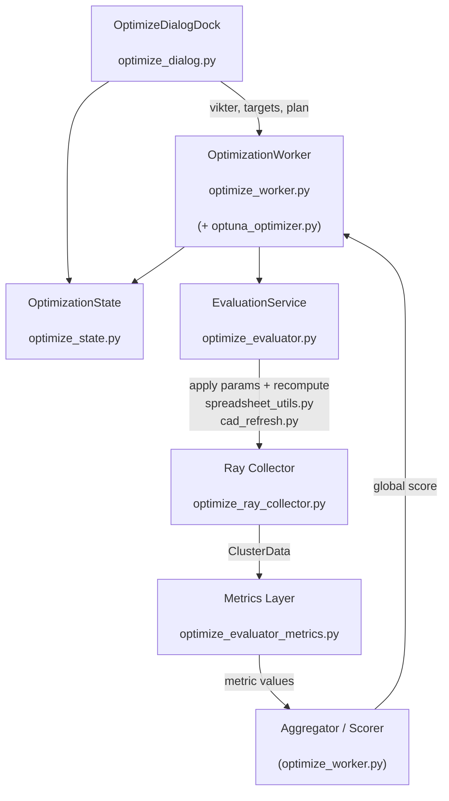
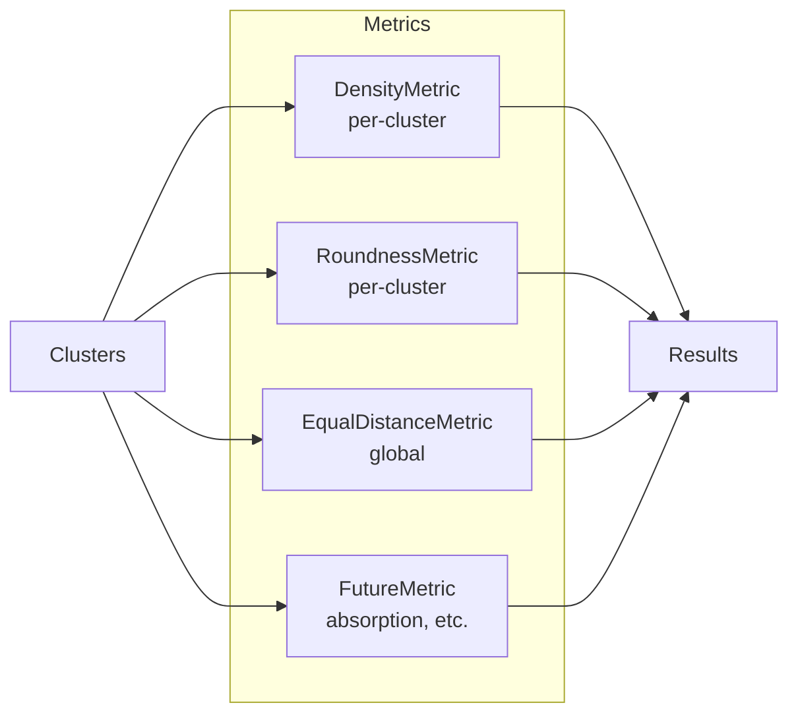

#### Träd

    UI
    └─ optimize_dialog.py
    ├─ sliders (weights)
    ├─ target editor
    ├─ plane / eq‑mode
    └─ skickar signaler till worker

    State
    └─ optimize_state.py
    └─ håller targets, plane, historia, aktiv status

    Worker / Orchestrator
    └─ optimize_worker.py
    ├─ Optuna-loop
    ├─ viktning
    ├─ global score
    └─ equal-distance-logik

    Evaluation
    └─ optimize_evaluator.py
    ├─ apply_cad_params (spreadsheet_utils.py)
    ├─ recompute_doc (cad_refresh.py)
    └─ anropar collector

    Collector
    └─ optimize_ray_collector.py
    └─ samlar kluster, centroider, rådata

    Metrics
    └─ optimize_evaluator_metrics.py
    ├─ density_score
    ├─ roundness_score_from_cov
    └─ (framtida metrics)

    Optuna
    └─ optuna_optimizer.py
    └─ trial / suggest / report

#### Nästa ..

