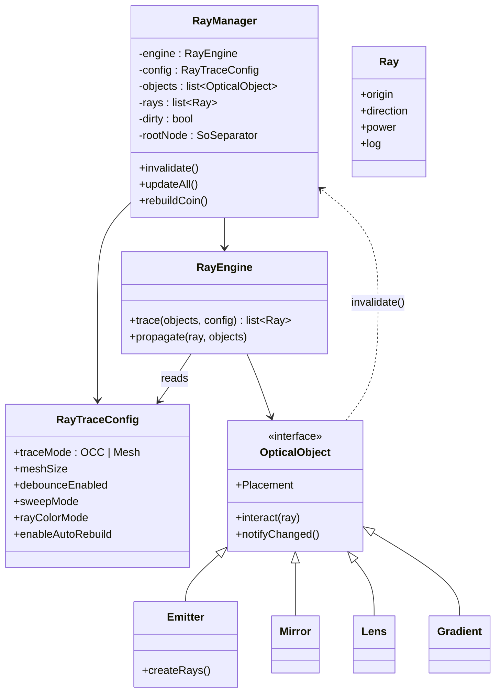
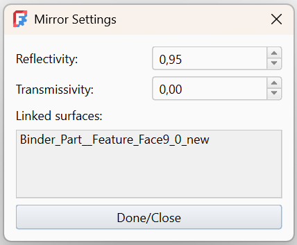

### 

### 🪞 Optical object — Mirror properties

Reflectivity
Controls how much of the incoming ray power is reflected by the surface.

Value range: 0.0 – 1.0
1.0 means a perfect mirror (all light reflected)
Lower values simulate lossy or coated mirrors

Reflected rays continue according to the law of reflection.

### Transmissivity

Controls how much of the incoming ray power passes through the surface.

Value range: 0.0 – 1.0
Used to model semi‑transparent or beam‑splitting surfaces
Transmission and reflection are handled independently

A transmitted ray continues in the incoming direction

### 🔦 Emitter — Optical source properties

Power
Total emitted optical power.

Controls the total power distributed across all generated rays
The ray weights are normalized internally
Unitless, but typically interpreted as relative or physical power

Wavelength
Central wavelength of emitted rays.

Used for wavelength‑dependent effects (e.g. gratings, dispersion)
Typically specified in nanometers
May be overridden by spectral splitting elements downstream

Max Rays
Maximum number of rays generated by the emitter.

Higher values give smoother results at the cost of performance
Controls sampling density over the emitting surface

Spread Angle
Angular spread of emitted rays.

0 produces a perfectly collimated source
Larger values create a divergent beam
Spread is applied around the surface normal

Lambertian
Enables Lambertian emission.

When enabled, ray intensity follows a cosine distribution
Useful for modeling diffuse or extended sources

Flip Normal
Inverts the surface normal used for emission.

Useful when geometry normals point in the undesired direction
Affects emission direction only

Linked surfaces
Lists all emitting surfaces.
Each listed surface represents a ShapeBinder referencing a geometry face.
All rays are emitted from these referenced surfaces.
Clicking a surface entry removes it.

### 🌈 Grating — Diffraction properties

Lines per mm
Groove density of the grating.

Higher values increase angular dispersion
Typical values: 300, 600, 1200

Orders
Diffraction orders to simulate.

m = 0 → undeviated beam
m = ±1 → primary spectral orders
Higher orders increase spread but usually reduce intensity

Orders are evaluated independently.

Spectrum Rays
Spectral sampling resolution per diffractive order.

Controls how many wavelength samples are generated
Higher values produce smoother spectra
Affects performance directly

Efficiency
Simplified energy efficiency factor.

Defines how much of the incoming power is distributed into diffracted rays
Used as a uniform loss model

Flip Normal
Inverts the surface normal used for diffraction.

Useful if diffraction appears mirrored or inverted
Does not change the groove direction

Linked surfaces
Lists all surfaces acting as diffraction gratings.
Rays interact only with these referenced faces.

🧪 Absorber / Detector — Collection properties
Absorption
Fraction of incoming ray power that is absorbed.

1.0 → full absorption (ideal detector)
0.0 → transparent surface

Unabsorbed power continues propagation.

Linked surfaces
Lists all absorbing or detecting surfaces.
These surfaces collect ray interactions and may be used for analysis,
power maps, or visualization.

⚙️ Ray Configuration — Simulation control
Trace Mode
Selects the ray intersection backend.

OCC (exact geometry)
Mesh‑based (faster for complex scenes)

Max Bounce
Maximum number of interactions per ray.

Prevents infinite ray loops
Useful for multi‑pass systems

Max Ray Length
Maximum propagation distance.

Rays exceeding this length terminate automatically

Color by Bounce
Visualizes ray paths using bounce count.

Useful for debugging and educational purposes
Does not affect physical computation

## ghjjjj
